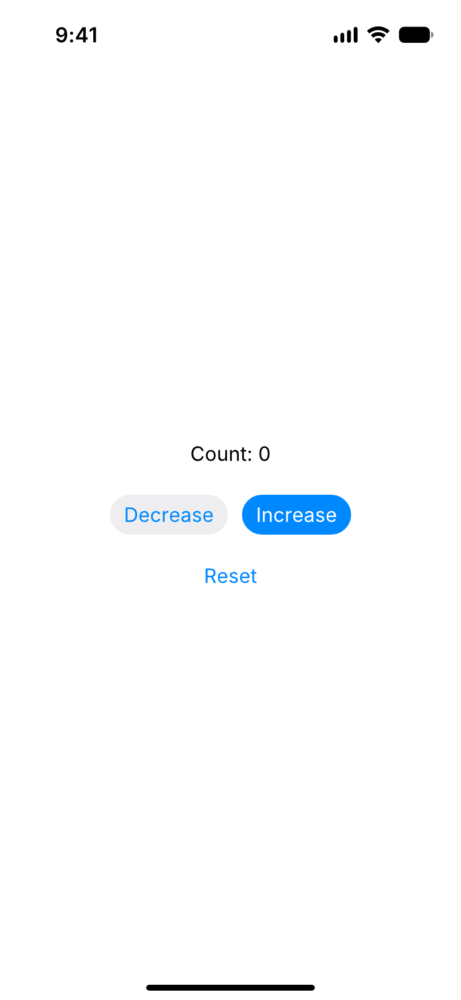
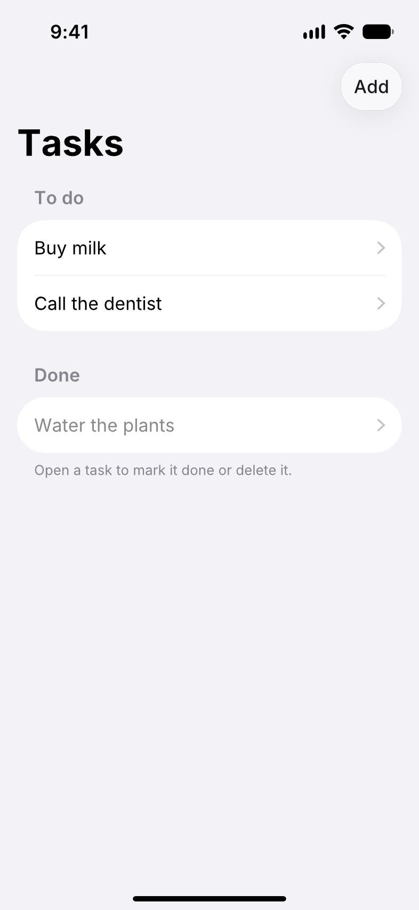
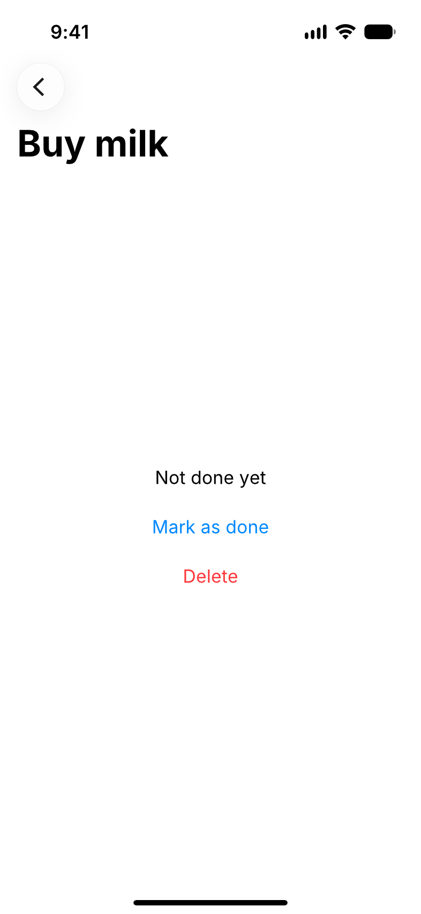
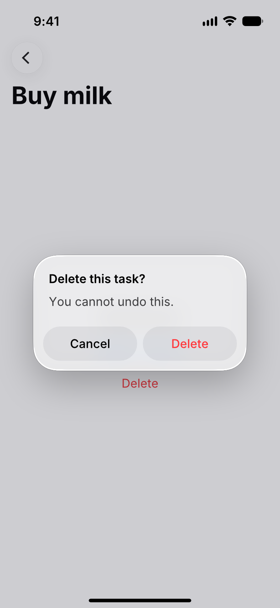
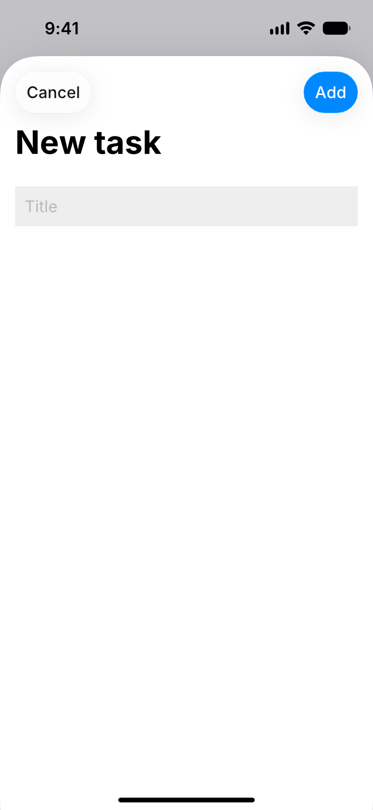

# Parhelion

[](https://github.com/JarrarDoga/parhelion/actions/workflows/ci.yml)
[](LICENSE)

SwiftUI for Linux, built for coding agents.

Parhelion is an open-source implementation of the SwiftUI API that runs natively on Linux. Your
app's source, `import SwiftUI` included, compiles against Parhelion without changes. Parhelion runs
it in a live preview window that reloads when you save, and you use the app with your mouse and
keyboard. The same runtime exposes the view tree, the state, and the input as a programming
interface, so a coding agent can check what is on screen and what happens when it taps, instead
of guessing from a screenshot.

> [!NOTE]
> Parhelion is pre-alpha. Today it resolves, lays out, and draws views, keeps state, and runs apps
> in a preview window that reloads when you save, where you tap, scroll, and type with your mouse
> and keyboard. Coding agents drive the same apps through an MCP server. See [Status](#status)
> and the [roadmap](docs/roadmap.md).

## Why Parhelion

You can already build, sign, and install a real iOS app from Linux with
[xtool](https://github.com/xtool-org/xtool). What is missing is the inner loop: seeing a change
and checking that it works, without a phone or a Mac at hand. Agents need more than a picture of
the screen. They need to know what each element is, which elements accept input, and what
changed after an action.

- **One codebase.** On Linux, `import SwiftUI` resolves to Parhelion. On iOS, it resolves to Apple's
  framework. The same package builds for both.
- **A live preview.** Your app runs in a phone-sized window on your Linux desktop. Click to tap,
  scroll with the mouse wheel or by dragging, and type with the keyboard. Saving a file reloads
  the app.
- **Made for agents.** The resolved view tree is plain `Codable` data with stable structural
  identifiers. The preview window, unit tests, and agents all drive the app through the same
  `ViewHost` API, with or without a window.

## Example

```swift
import SwiftUI

struct Counter: View {
    @State private var count = 0

    var body: some View {
        VStack {
            Text("Count: \(count)")
            Button("Increment") { count += 1 }
        }
    }
}
```

Host the view, drive it, and read the result:

```swift
let host = ViewHost(Counter())
try host.tapButton(labeled: "Increment")
print(host.root.outline(includeIDs: true))
```

```text
Root
└─ VStack  #Counter/VStack
   ├─ Text "Count: 1"  #Counter/VStack/0/Text
   └─ Button  #Counter/VStack/1/Button
      └─ Text "Increment"  #Counter/VStack/1/Button/Text
```

Parhelion draws the screen itself. This image of the `Counter` example came from
`swift run Counter --png docs/images/counter.png`:

<p align="center">
  
</p>

The `Tasks` example shows the rest of the iOS 27 interface: a large title and a list, a pushed
screen with a glass back button, an alert, and a sheet with glass toolbar buttons. Its images come
from `PARHELION_README_IMAGES=docs/images swift test --filter writeReadmeImages`, which taps
through the app with `ViewHost`:

<p align="center">
  
  
  
  
</p>

The bundled `HelloParhelion` example is the app that `xtool new` generates, copied without changes:

```console
$ swift run HelloParhelion
Root
└─ VStack padding(16)
   ├─ Image foregroundStyle=tint imageScale=large systemName=globe
   └─ Text "Hello, world!"
```

Pass `--png PATH` to draw the screen to an image, `--frames` to show each node's frame in points,
`--ids` to show node identifiers, or `--json` for the tree as JSON:

```console
$ swift run HelloParhelion --frames
Root  [0, 0, 393 × 852]
└─ VStack padding(16)  [146.21, 412.54, 100.57 × 51.93]
   ├─ Image foregroundStyle=tint imageScale=large systemName=globe  [185.54, 412.54, 21.93 × 21.93]
   └─ Text "Hello, world!"  [146.21, 442.47, 100.57 × 22]
```

## Preview window

The `parhelion` tool runs a built app in a window on your Linux desktop. You click to tap, and a
button dims while you hold it, as on iOS. The tool needs SDL3:

```console
$ sudo dnf install SDL3-devel          # Fedora
$ sudo apt install libsdl3-dev         # Ubuntu 25.04 or later
$ swift build -c release --package-path Tools/parhelion-cli
$ cp Tools/parhelion-cli/.build/release/parhelion ~/.local/bin/
```

Then run your app's package:

```console
$ parhelion run --package-path ~/Code/MyApp
Building MyApp: debug build of the app, with Parhelion optimized...
Running MyApp. Save a file to reload. Close the window to quit.
Change detected. Rebuilding...
Reloaded in 1.44 s: build 1.42 s, restart 0.02 s.
```

`parhelion run` builds the app, opens it, and watches the package's Swift files. When you save,
it rebuilds in the background and restarts the app in the same window. `@State` values whose type
is `Codable` keep their values across the reload. If the build fails, the errors appear in the
terminal with paths to your own files, and the last working version keeps running.

It runs a package's executable product, or, for apps created with `xtool new`, the library's
`@main` type, through a small generated runner package. To open an already-built executable
without watching, use `parhelion preview .build/debug/Counter`.

The window shows the screen inside a phone, like the iOS Simulator, with the status bar, the
Dynamic Island, and the home indicator. `--device` picks the iPhone to simulate: iPhone 16 (the
default), 16 Plus, 16 Pro, 16 Pro Max, 16e, 17, 17 Pro, 17 Pro Max, Air, 18 Pro, or 18 Pro Max,
as in `parhelion run --device "iPhone 18 Pro Max"`. `--no-bezel` shows the screen without the
phone around it. `--zoom` changes the window size, and `--scale` changes the pixels per point the
app renders at.

Animation in the window follows the display: the window waits for each refresh, at 60, 180, or
240 Hz, and the app draws each frame for the moment it will be on screen. It never runs faster
than the iPhone it simulates: 120 frames per second on models with ProMotion, which is every
other refresh on a 240 Hz display, and 60 on iPhone 16, 16 Plus, and 16e. By default
`parhelion run` builds your app without optimization, so a one-line edit rebuilds in about a
second, and Parhelion with optimization, so frames render as fast as in a release build. If your
package pins Parhelion to a version, SwiftPM does not allow that split, and `parhelion run`
optimizes the whole build instead; it says so when it starts. `parhelion run -c release` builds
everything optimized. Builds go to `.build/parhelion`, so they do not disturb your own
`swift build`.

The app draws its own frames and sends them to the window over a local socket, so the same app
can also run with no window at all, for tests and agents.

## Agents

`parhelion mcp` serves your app to a coding agent over the Model Context Protocol. Register it
with Claude Code from your app's directory:

```console
$ claude mcp add parhelion -- parhelion mcp --package-path .
```

The agent gets these tools:

| Tool | What it does |
| --- | --- |
| `get_view_tree` | The screen as a tree of views with identifiers and frames, as an outline or JSON |
| `screenshot` | A PNG of the screen, with the status bar and the home indicator |
| `tap`, `type_text`, `press_key` | Tap by identifier, label, or position; type into text fields; Tab, Return, Backspace, and the caret keys |
| `scroll`, `scroll_to`, `drag`, `wait` | Scroll like a mouse wheel, to an offset, or by dragging with momentum, and wait for it to settle |
| `rebuild`, `app_output` | Rebuild after editing the code, keeping `@State`, with compiler errors on failure; read what the app printed |

Each interaction reports the screen's revision, so the agent can tell whether it changed
anything. Add `--window` to watch the app in a preview window and use it yourself while the agent
works.

## Status

| Area | Supported today |
| --- | --- |
| Views | `Text`, `Image`, `Button`, `TextField`, `VStack`, `HStack`, `ZStack`, `Spacer`, `Color`, `ScrollView`, `List`, `Section`, `ForEach`, `NavigationStack`, `NavigationLink`, `EmptyView`; sheets, full-screen covers, and alerts |
| Builders | Multiple children, `if`/`else`, optional content |
| State | `@State` and `@Binding`, with SwiftUI's structural identity and lifetime rules; `@Environment` with `dismiss`, `isPresented`, and custom keys |
| Modifiers | `padding`, `frame` (fixed and flexible), `background`, `foregroundStyle`, `font`, `fontWeight`, `bold`, `imageScale`, `listStyle`, `navigationTitle`, `navigationBarTitleDisplayMode`, `navigationDestination`, `toolbar`, `opacity`, `offset`, `animation`, `transition`, and `Color.opacity` |
| Animation | `withAnimation` and `animation(_:value:)` with timing curves and springs on a deterministic clock; opacity, move, slide, offset, and push transitions; animated navigation and presentations |
| Layout | SwiftUI's propose-and-respond stack algorithm, iOS text styles and text wrapping with the bundled Inter font in four weights, large and inline navigation titles, the screens and safe areas of nine iPhones from iPhone 16 to iPhone 17 Pro Max |
| Input | Tap by node, by button label, or by screen position; press, drag away to cancel, and release with the mouse; scroll by dragging with momentum, or with the mouse wheel and trackpad; type into text fields, with the caret keys, Backspace, Delete, and Tab between fields |
| Window | `parhelion run` with hot reload that keeps `Codable` state, and `parhelion preview`; an SDL3 window host for Wayland and X11 that shows the screen in a phone bezel |
| Agents | `parhelion mcp`, with or without a window |
| Rendering | Anti-aliased shapes and Inter text drawn in pure Swift at any scale, with PNG output; iOS 27's system colors and inset grouped lists; the status bar, Dynamic Island or notch, home indicator, and rounded screen corners; SF Symbols draw as placeholder rings |
| App | `App`, `Scene`, `WindowGroup`, with a headless runner |

Not yet available: text selection, letter spacing, iOS 27's Liquid Glass toolbar buttons, alerts,
and sheets, button styles, most built-in environment values, scale and rotation effects, repeating animations, animation, and gestures other than tap. Layout constants that Parhelion assumes about
SwiftUI, such as the default padding, are listed in `LayoutDefaults.swift` until a macOS CI job
verifies them. The [roadmap](docs/roadmap.md) lists the
order of work.

## Requirements

- Linux on x86_64. CI tests x86_64 only; arm64 should work but is not tested yet.
- Swift 6.3 or later
- SDL3, only for the `parhelion` preview window

The `SwiftUI` module exists only on Linux, so it never shadows Apple's framework.

## Installation

Add Parhelion to your app's `Package.swift`, and depend on its `SwiftUI` product on Linux only:

```swift
dependencies: [
    .package(url: "https://github.com/JarrarDoga/parhelion.git", branch: "main")
],
targets: [
    .target(
        name: "MyApp",
        dependencies: [
            .product(name: "SwiftUI", package: "parhelion", condition: .when(platforms: [.linux]))
        ]
    )
]
```

When you build for iOS, for example with `xtool dev`, the condition excludes Parhelion and the app
links Apple's SwiftUI. When you build on Linux, the same sources compile against Parhelion.

Parhelion has no tagged release yet. Pin a version once `0.1.0` is out.

## How it works

`ViewHost` evaluates a view's `body` recursively until it reaches primitive views, and records
each one as a `ViewNode`. A layout pass then assigns every node a frame, using SwiftUI's model:
the parent proposes a size, the child picks its size, and the parent places it. `@State` storage
belongs to the host and is keyed by a view's structural position, so state survives updates and
is discarded when the view leaves the tree. Taps run the button's action, and the host evaluates
and lays out the tree again.

`ViewHost.render(scale:)` then draws the tree into pixels with Parhelion's own rasterizer, which
needs no GPU and no system libraries, so screenshots look the same on every machine.

The [architecture overview](docs/architecture.md) covers the design. The
[decision records](docs/adr/) explain the choices behind it.

## Contributing

Contributions are welcome. Read [CONTRIBUTING.md](CONTRIBUTING.md) for the development setup and
the pull request process. Everyone who takes part must follow the
[Code of Conduct](CODE_OF_CONDUCT.md). To report a security issue, follow
[SECURITY.md](SECURITY.md).

## The name

A parhelion, or sun dog, is a bright image of the sun that appears beside it. Parhelion shows an
image of your iOS app beside the real one.

## License

Parhelion is available under the [Apache License 2.0](LICENSE).

Parhelion is an independent project. It is not affiliated with, sponsored by, or endorsed by
Apple Inc. Apple, iOS, SwiftUI, and Xcode are trademarks of Apple Inc. Parhelion contains no Apple
source code.
